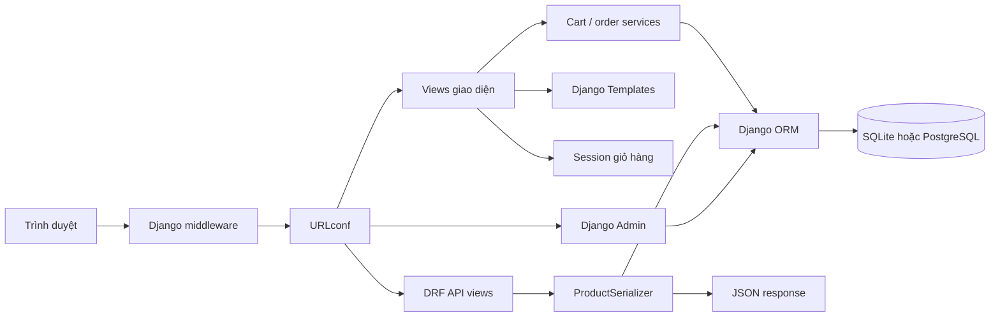

# Bean & Leaf — Báo cáo kỹ thuật

## 1. Tổng quan

Bean & Leaf là ứng dụng thương mại điện tử một khối chạy trên Django. Giao diện HTML được render bằng Django Templates; Django REST Framework cung cấp API catalogue chỉ đọc. SQLite là database mặc định, còn cấu hình có thể dùng PostgreSQL thông qua `DATABASE_URL`.

Các luồng hiện có gồm catalogue, giỏ hàng trong session, voucher freeship, checkout COD, tài khoản/hồ sơ, đánh giá sản phẩm, chia sẻ mạng xã hội và quản lý qua Django Admin. Hướng dẫn cài đặt nằm trong [README](../README.md); kịch bản trình diễn nằm trong [DEMO](DEMO.md).

## 2. Kiến trúc ứng dụng

| Django app | Trách nhiệm |
| --- | --- |
| `core` | Trang chủ, trang nội dung và context processor cho số lượng hàng trong giỏ |
| `products` | Danh mục/sản phẩm, bộ lọc catalogue, chi tiết, review/rating, API và metadata chia sẻ |
| `cart` | Đọc/ghi giỏ session, lấy sản phẩm đang bán và tính tổng tiền, phí giao, voucher |
| `accounts` | Đăng ký/đăng nhập, hồ sơ/avatar, lịch sử đăng nhập và signal khởi tạo dữ liệu tài khoản |
| `promotions` | Voucher freeship gắn với tài khoản và trạng thái đã sử dụng |
| `orders` | Checkout COD, đơn hàng, snapshot mặt hàng và Admin trạng thái |

Các phần trong sơ đồ là module của cùng một ứng dụng Django, không phải dịch vụ triển khai độc lập. Middleware xử lý session, xác thực và CSRF trước khi view chạy. View giao diện gọi ORM/selector/service và render template; API chuyển dữ liệu qua serializer; Admin dùng cùng model và database.

## 3. Mô hình dữ liệu và luồng nghiệp vụ

### Catalogue

`Product` thuộc một `Category` và có giá VND, mức rang, xuất xứ, tồn kho, ảnh, cờ nổi bật và trạng thái hoạt động. Storefront và API chỉ truy vấn sản phẩm `is_active=True`. Catalogue HTML tìm theo tên/mô tả, lọc danh mục, mức rang và khoảng giá, rồi phân trang 9 sản phẩm. API có bộ lọc riêng, được mô tả ở mục 4. Trang chi tiết hiển thị tối đa 4 sản phẩm cùng danh mục.

### Tài khoản và voucher

Khi tạo user, signal tạo `UserProfile` và voucher freeship có mã `FREESHIP-` theo ID user. Đăng nhập thành công ghi thời điểm và địa chỉ `REMOTE_ADDR`; nếu ứng dụng đứng sau proxy, giá trị này có thể là IP của proxy. Trang hồ sơ yêu cầu đăng nhập, hiển thị tên đầy đủ hoặc username, avatar, tối đa 20 lần đăng nhập gần nhất và đơn gắn với user hiện tại. Form hồ sơ chỉ cập nhật avatar. Management command `prune_login_history` xóa lịch sử cũ hơn 12 tháng; cần được lập lịch riêng nếu muốn tự động dọn dữ liệu.

Voucher gắn với một user và chỉ được áp dụng khi thuộc user đó, chưa sử dụng. Phí giao hàng mặc định là 30.000đ với giỏ có sản phẩm; voucher hợp lệ đưa phí về 0đ. Khách vãng lai không nhận được voucher tài khoản.

### Giỏ hàng và đơn COD

Session lưu ID sản phẩm và số lượng. Service tải lại các sản phẩm đang hoạt động, tính tiền theo giá hiện tại và tạo bản tóm tắt đơn. Checkout yêu cầu họ tên, số điện thoại, email, địa chỉ và `payment=cod`; phương thức khác bị từ chối. Đơn mới gắn với user nếu đã đăng nhập, nếu không thì `user` để trống. `OrderItem` lưu tên và đơn giá tại thời điểm đặt hàng.

Sau khi tạo đơn, view xóa giỏ và voucher khỏi session, đánh dấu voucher đã dùng nếu đơn có voucher rồi chuyển tới trang xác nhận. Mã đơn có dạng `BL` kèm chuỗi ngẫu nhiên. Trạng thái ban đầu là `delivery_status=packing` và `payment_status=pending`. Admin thay đổi trạng thái giao hàng và thanh toán riêng; chuyển sang `delivered` không tự đổi trạng thái thanh toán. Khách thấy trạng thái giao hàng trong hồ sơ sau khi tải lại trang.

Hiện checkout chưa trừ tồn kho, chưa bọc toàn bộ tạo đơn và đánh dấu voucher trong một transaction/khóa xử lý đồng thời, chưa gửi email xác nhận và chưa tích hợp thanh toán trực tuyến. Không có quy trình tự động buộc các trạng thái giao hàng theo một thứ tự.

### Đánh giá và chia sẻ

Người xem có thể đọc đánh giá, số lượng và điểm trung bình. POST review yêu cầu đăng nhập; điểm từ 1 đến 5, nội dung tùy chọn dài tối đa 2.000 ký tự. Unique constraint `(product, user)` bảo đảm một đánh giá mỗi user/sản phẩm; gửi lại cập nhật đánh giá hiện có. Database có check constraint cho khoảng điểm. Không yêu cầu người đánh giá đã mua hàng.

Template dùng autoescape mặc định; kiểm tra hiện có xác nhận HTML trong nội dung review được escape. Trang chi tiết có liên kết Facebook, Zalo và sao chép liên kết. `ZALO_OA_ID` bật widget Zalo; Open Graph dùng ảnh sản phẩm hoặc ảnh mặc định. Preview cần URL và ảnh truy cập công khai; localhost chỉ đủ để xem markup.

## 4. API catalogue

Hai endpoint công khai, chỉ đọc:

| Endpoint | Response |
| --- | --- |
| `GET /api/products/` | Mảng JSON các sản phẩm đang hoạt động |
| `GET /api/products/<slug>/` | Object JSON của một sản phẩm đang hoạt động |

Danh sách hỗ trợ `search` trên tên/mô tả/xuất xứ, `category` theo slug danh mục và `roast` (`light`, `medium`, `dark`). Có thể kết hợp các tham số. API không hỗ trợ lọc giá hoặc phân trang. Danh sách không khớp trả `[]`; sản phẩm detail không tồn tại hoặc không hoạt động trả 404; POST trả 405.

`ProductSerializer` trả 13 trường: `id`, `name`, `slug`, `url`, `category`, `category_slug`, `description`, `price`, `roast_level`, `roast_label`, `origin`, `stock` và `is_featured`. `category` là chuỗi tên, `price` là số nguyên VND. API chưa trả ảnh, đánh giá hoặc ngày tạo. Chi tiết request/response và lệnh gọi mẫu nằm trong [README — API catalogue](../README.md#api-catalogue); khai báo trường trong [serializer](../products/serializers.py).

## 5. Truy vấn và tối ưu đã ghi nhận

Catalogue, chi tiết, trang chủ, sản phẩm liên quan và API dùng `select_related('category')`; review dùng `select_related('user')`. Đo trước/sau trên GET qua test client trong đợt Week 6 ghi nhận:

| Trang và fixture | Trước | Sau | Thay đổi |
| --- | ---: | ---: | --- |
| Giỏ, 1 sản phẩm | 3 query | 2 query | Join category cùng Product |
| Giỏ, 3 sản phẩm khác danh mục | 5 query | 2 query | Loại query Category tăng theo số sản phẩm |
| Profile, 1 đơn/item | 7 query | 6 query | Prefetch `items`, bỏ tải Product không dùng |
| Profile, 3 đơn/item | 7 query | 6 query | Giữ 1 query OrderItem, không truy vấn Product |

Đo giỏ dùng khách chưa đăng nhập; đo profile dùng user đăng nhập. Khởi tạo session/xác thực nằm ngoài vùng đo. Template hồ sơ dùng `OrderItem.product_name` đã lưu tại thời điểm mua nên không cần tải quan hệ `items__product`. Đây là số query với fixture SQLite local, không phải phép đo tải hoặc độ trễ production.

Các index hiện có bao gồm Product `(is_active, category)` và `(is_active, roast_level)`, review `(product, -created_at)`, lịch sử đăng nhập `(user, -created_at)`, và index đơn hàng/item. Chưa có query plan hoặc tải dữ liệu lớn để kết luận thêm về hiệu quả thực tế; chưa bổ sung cache.

## 6. Cấu hình bảo mật và triển khai

| Khu vực | Hành vi cấu hình | Điều kiện triển khai |
| --- | --- | --- |
| Environment | `python-dotenv` đọc `.env`; environment của tiến trình ưu tiên; `.gitignore` loại `.env` | Không commit secret; cấp `SECRET_KEY` riêng, ổn định |
| Host/DEBUG | `DEBUG=0` yêu cầu `SECRET_KEY` và `ALLOWED_HOSTS` | Khai báo hostname thật; dùng `DEBUG=1` cho local |
| HTTPS/cookie | Khi `DEBUG=0`, mặc định bật redirect HTTPS, secure session/CSRF cookie và HSTS 31.536.000 giây | Cần TLS thật; HSTS chỉ được gửi trên HTTPS |
| HSTS mở rộng | Include-subdomains/preload mặc định tắt | Chỉ bật sau khi xác nhận HTTPS cho mọi subdomain và chính sách domain |
| Reverse proxy | `USE_X_FORWARDED_PROTO` mặc định tắt | Chỉ bật sau proxy TLS tin cậy có ghi đè header `X-Forwarded-Proto` |
| CSRF | Middleware và token bảo vệ form; test hiện có xác nhận POST review thiếu token bị từ chối | Test này không thay thế rà soát mọi endpoint |
| HTML người dùng | Django autoescape; test review xác nhận nội dung HTML độc hại được escape | Đây không phải chứng nhận an toàn toàn ứng dụng |
| Static/media | WhiteNoise được cài cho static; `STATIC_ROOT=staticfiles`; media ở `MEDIA_ROOT` | Chạy `collectstatic`; cung cấp media qua lưu trữ/web server bền vững |
| Database | SQLite mặc định; `DATABASE_URL` có thể cấu hình PostgreSQL | Cần backup/restore phù hợp với database đang dùng |

Ứng dụng có WSGI entry point tại `config/wsgi.py` và cấu hình phục vụ trên Vercel tại `api/vercel.json` (runtime Python 3.11). `runserver` chỉ dành cho phát triển; môi trường thật cần runtime phù hợp, HTTPS, hostname, lưu trữ bền vững và backup. Django chỉ tự thêm route media khi `DEBUG=1`.

`manage.py check --deploy` trên cấu hình local `DEBUG=1` đã ghi nhận 5 cảnh báo dự kiến về HSTS, HTTPS redirect, secure cookies và DEBUG (`W004`, `W008`, `W012`, `W016`, `W018`). Lần kiểm tra production có kiểm soát được báo cáo trước đó còn `W005`/`W021` cho HSTS include-subdomains/preload, mặc định tắt có chủ đích. Những kết quả này không xác minh chứng chỉ TLS, proxy hoặc cấu hình server thật. Danh sách biến và hướng dẫn thiết lập ở [README — Cấu hình và triển khai](../README.md#cấu-hình-và-triển-khai).

## 7. Kiểm chứng, thách thức và giới hạn

Báo cáo kết quả trước đó ghi nhận 40 test đạt: 36 test baseline, 2 test query và 2 test bảo mật. Các test bao phủ catalogue/API, giỏ/voucher, COD, profile/quyền sở hữu/avatar/lịch sử đăng nhập, review/chia sẻ, CSRF, escaping và hồi quy truy vấn. Đây là kết quả được ghi nhận trong đợt Week 6; báo cáo này không chạy lại test.

| Vấn đề được ghi nhận | Cách xử lý | Giới hạn |
| --- | --- | --- |
| Giỏ tải category riêng theo từng sản phẩm | Join category; số query đo được giảm từ 3/5 xuống 2/2 | Chưa đo tải lớn hoặc độ trễ production |
| Hồ sơ tải Product dù chỉ hiển thị snapshot tên mua | Prefetch order items và bỏ quan hệ Product không dùng; 7 xuống 6 query | Đơn hàng và đánh giá chưa phân trang |
| Trạng thái giao COD có thể bị nhầm với trạng thái thu tiền | Tách `delivery_status` và `payment_status`; Admin chỉnh riêng | Chưa có quy trình trạng thái tự động |
| Response API raw list có thể tăng theo catalogue | README và report nêu rõ chưa phân trang | Cần thiết kế phân trang khi quy mô catalogue đòi hỏi |
| Thiết lập local khác yêu cầu production | Giá trị bảo mật phụ thuộc `DEBUG`; proxy header là opt-in | Chưa xác minh TLS/proxy trên môi trường thật |

Kết quả test và query count là kiểm tra local, không phải clean-machine installation, kiểm thử tải, benchmark độ trễ hay security audit toàn diện. Chi tiết các lệnh chạy và phạm vi giới hạn được nêu trong [README](../README.md#kiểm-tra-và-tài-liệu-khác).
